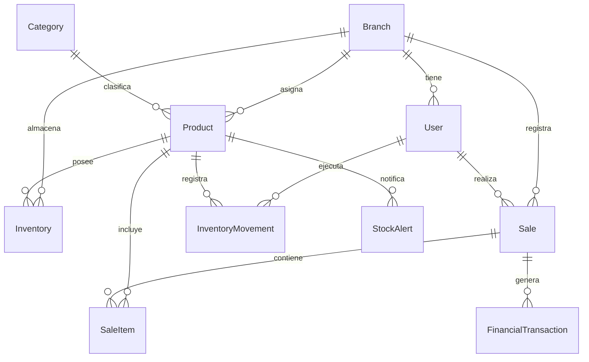
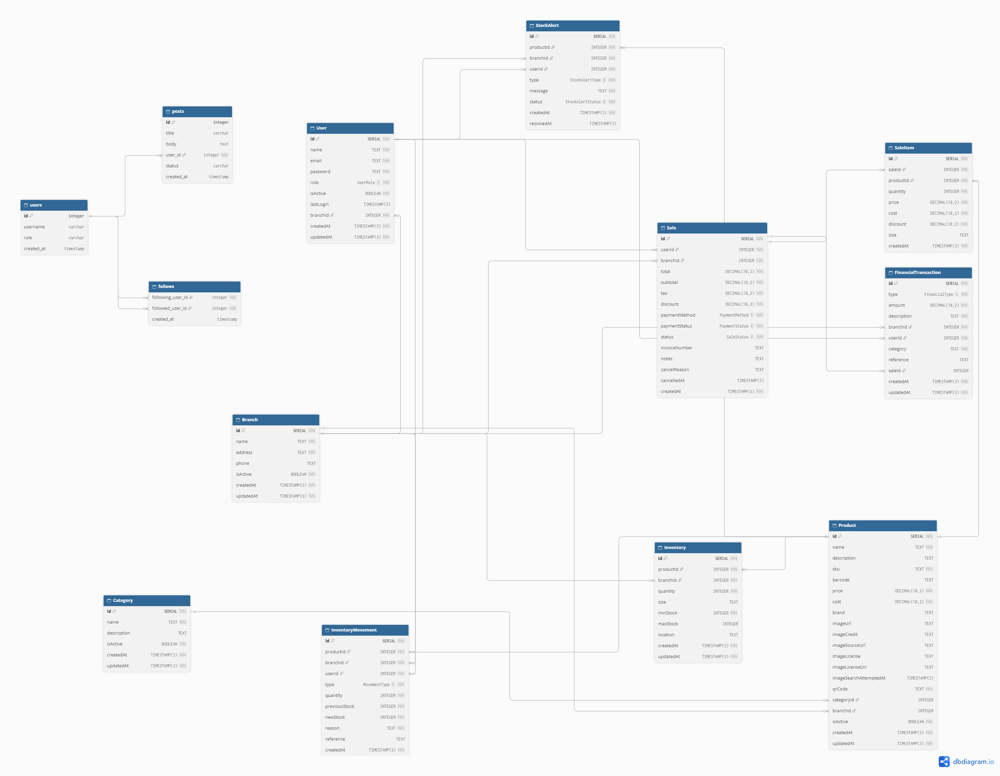

# Deyfus
Sistema de gestión de inventario, ventas y finanzas con panel de análisis de datos.
- **Repositorio original**: [https://github.com/EstebanJagger/deyfus](https://github.com/EstebanJagger/deyfus)
- **Licencia**: MIT

## Despliegue
- **App (Frontend en Vercel)**: [La pagina](https://deyfus.vercel.app/)
- **Dashboard (Looker Studio o Data Studio)**: [Ver reporte interactivo](https://datastudio.google.com/reporting/ffc04765-1c00-4f4a-9450-749a63f7f685)
*(Nota: La API backend se encuentra desplegada de forma privada en Render y es consumida exclusivamente por el frontend y se debe elegir sucursal para que salgan los datos :> ).*

## Ejecución local

1. **Requisitos**: Node 18+, Git, PostgreSQL.
2. **Clonar repositorio**:
   ```bash
   git clone https://github.com/EstebanJagger/deyfus.git
   cd deyfus
   ```
3. **Backend**:
   - Copia `.env.example` a `.env` y completa las variables.
   - Instala dependencias y levanta la base de datos:
     ```bash
     npm install
     npx prisma generate
     npx prisma db push
     npm run dev
     ```
4. **Frontend**:
   - Crea un archivo `.env` configurando `VITE_API_URL` y `VITE_LOOKER_EMBED_URL`.
   - Ejecuta:
     ```bash
     npm install
     npm run dev
     ```

## Variables de entorno

| Variable | Descripción |
|----------|-------------|
| `DATABASE_URL` | Cadena de conexión a la base de datos PostgreSQL local o remota. |
| `JWT_SECRET` | Clave secreta para la firma y validación de tokens de autenticación. |
| `PORT` | Puerto de ejecución del servidor backend (por defecto 3000 o 3001). |
| `VITE_API_URL` | URL base para las peticiones del frontend hacia el backend (ej. `http://localhost:3000`). |
| `VITE_LOOKER_EMBED_URL` | URL del iframe para incrustar el dashboard de Looker Studio. |

## Modelo de datos

El sistema utiliza un modelo relacional centrado en Sucursales (`Branch`), administrando Usuarios (`User`), Inventario (`Inventory`), Ventas (`Sale`) y Finanzas (`FinancialTransaction`).




- **Branch**: Sucursales físicas o puntos de venta.
- **User**: Empleados con niveles de acceso (`ADMIN`, `MANAGER`, `SELLER`).
- **Product & Category**: Catálogo base de artículos, incluyendo códigos de barras y QR.
- **Inventory & InventoryMovement**: Control de stock por sucursal y registro de auditoría de entradas, salidas y ajustes.
- **Sale & SaleItem**: Transacciones comerciales, métodos de pago y detalle de productos vendidos.
- **FinancialTransaction**: Registro de ingresos y egresos vinculados a las ventas.
- **StockAlert**: Alertas automáticas para niveles de inventario mínimos (`LOW_STOCK`) o excesivos (`OVERSTOCK`).

## Scripts SQL y Datos de Prueba

El esquema estructural de la base de datos se encuentra en `database/schema.sql`. 
Si deseas poblar la base de datos con información inicial para pruebas (Sucursales, Usuarios, Productos, Ventas), puedes ejecutar el siguiente script `seed.sql`:

<details>
<summary><b>Haz clic aquí para ver el código de database/seed.sql</b></summary>

```sql
-- Insertar Sucursales (Branches)
INSERT INTO "Branch" (name, address, phone, "updatedAt") 
VALUES 
('Sede Principal', 'Calle Falsa 123', '555-0101', CURRENT_TIMESTAMP),
('Sucursal Norte', 'Av. Siempreviva 742', '555-0202', CURRENT_TIMESTAMP);

-- Insertar Usuarios (Contraseña: hash_del_password)
INSERT INTO "User" (name, email, password, role, "branchId", "updatedAt") 
VALUES 
('Admin General', 'admin@deyfus.com', 'hash_123', 'ADMIN', 1, CURRENT_TIMESTAMP),
('Vendedor Juan', 'juan@deyfus.com', 'hash_123', 'SELLER', 1, CURRENT_TIMESTAMP),
('Gerente Norte', 'gerente@deyfus.com', 'hash_123', 'MANAGER', 2, CURRENT_TIMESTAMP);

-- Insertar Categorías
INSERT INTO "Category" (name, description, "updatedAt") 
VALUES 
('Electrónica', 'Dispositivos y gadgets', CURRENT_TIMESTAMP),
('Accesorios', 'Cables, fundas y complementos', CURRENT_TIMESTAMP);

-- Insertar Productos
INSERT INTO "Product" (name, description, sku, barcode, price, cost, "qrCode", "categoryId", "branchId", "updatedAt") 
VALUES 
('Laptop Pro', 'Portátil de alto rendimiento', 'LAP-001', '7701234567890', 1200.00, 900.00, 'QR-LAP-001', 1, 1, CURRENT_TIMESTAMP),
('Mouse Inalámbrico', 'Mouse ergonómico 2.4GHz', 'MOU-001', '7701234567891', 25.00, 10.00, 'QR-MOU-001', 2, 1, CURRENT_TIMESTAMP);

-- Insertar Inventario
INSERT INTO "Inventory" ("productId", "branchId", quantity, "minStock", "updatedAt") 
VALUES 
(1, 1, 15, 5, CURRENT_TIMESTAMP),
(2, 1, 50, 10, CURRENT_TIMESTAMP),
(1, 2, 5, 5, CURRENT_TIMESTAMP);

-- Registrar Movimientos de Inventario
INSERT INTO "InventoryMovement" ("productId", "branchId", "userId", type, quantity, "previousStock", "newStock", reason) 
VALUES 
(1, 1, 1, 'ENTRY', 15, 0, 15, 'Inventario inicial'),
(2, 1, 1, 'ENTRY', 50, 0, 50, 'Inventario inicial');

-- Insertar una Venta (Sale)
INSERT INTO "Sale" ("userId", "branchId", total, subtotal, tax, discount, "paymentMethod", "paymentStatus", status) 
VALUES 
(2, 1, 1225.00, 1225.00, 0.00, 0.00, 'CARD', 'COMPLETED', 'COMPLETED');

-- Insertar Detalles de la Venta (SaleItem)
INSERT INTO "SaleItem" ("saleId", "productId", quantity, price, cost) 
VALUES 
(1, 1, 1, 1200.00, 900.00),
(1, 2, 1, 25.00, 10.00);

-- Insertar Transacción Financiera
INSERT INTO "FinancialTransaction" (type, amount, description, "branchId", "userId", category, "saleId", "updatedAt") 
VALUES 
('INCOME', 1225.00, 'Venta en mostrador', 1, 2, 'VENTAS', 1, CURRENT_TIMESTAMP);

-- Insertar Alerta de Stock
INSERT INTO "StockAlert" ("productId", "branchId", "userId", type, message, status)
VALUES
(1, 2, 3, 'LOW_STOCK', 'El stock de Laptop Pro ha llegado a su nivel mínimo en la Sucursal Norte.', 'PENDING');
```
</details>

## Dashboard
El panel interactivo en Looker Studio permite visualizar:
- **Ventas y Rentabilidad**: Gráficos de ingresos frente a costos a lo largo del tiempo.
- **Rendimiento por Sucursal**: Comparativas de ventas según la ubicación física.
- **Estado de Inventario**: Identificación rápida de productos con stock crítico.
- **Filtros**: Segmentación de datos por rango de fechas, categoría de producto y sucursal.